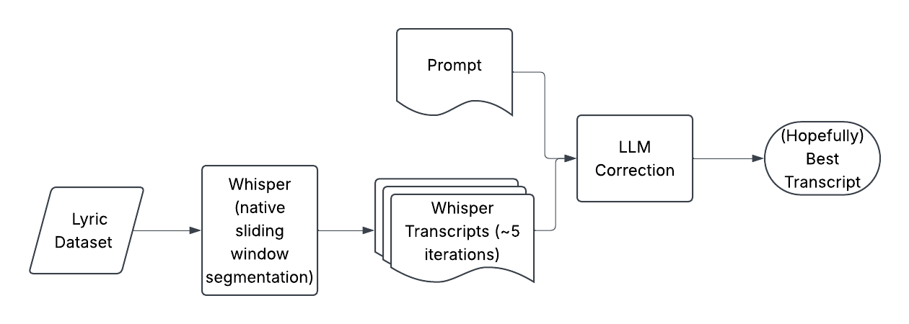
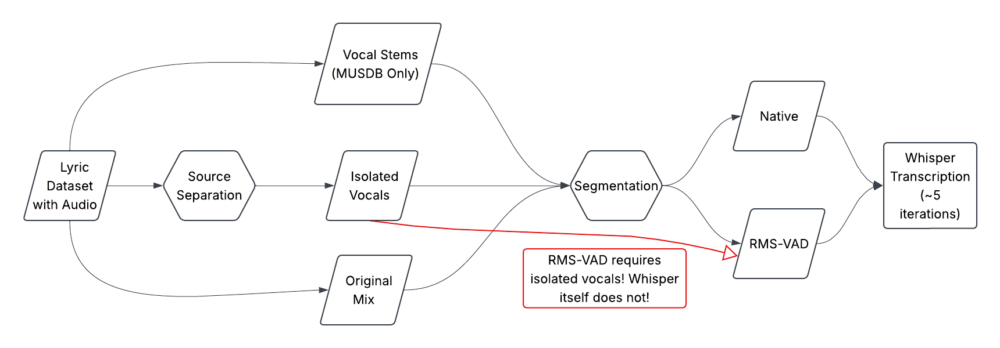
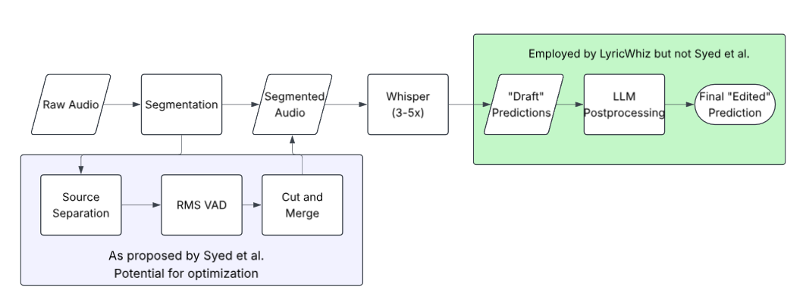

# Semester 1: Project

## Repository Structure
This repository contains two submodules, both of which I have forked: [mss-alt](https://github.com/clairesb/mss-alt.git), which corresponds to the work done in [this paper](https://arxiv.org/pdf/2506.15514), and [LyricWhiz](https://github.com/clairesb/LyricWhiz.git), introduced in [this paper](https://arxiv.org/abs/2306.17103). Both submodules can be found under `external`. 

`scripts` contains short scripts that automate oft-repeated actions.

`envs` contains information regarding setting up environments for various experiments.

`comparison_code` is currently empty but will contain code for comparing the word error rates (WERs) of various experiments.

`images` contains helpful diagrams!

## Phase 1: Literature Review
This is part of a [living thesis proposal draft document](https://www.overleaf.com/5648798344wkcchskrnkfm#7fad52). A pdf version can be found on canvas, or in this repository (Lit_Review.pdf).

LyricWhiz employs the following processto transcribe audio:

And mss-alt's process looks like this:

I hope to combine the pipelines in a fashion similar to this:

## Phase 2: Benchmarking
### AI Statement
I used AI to draft code, which I then reviewed and tested; I also used claude (my LLM of choice) to summarize stack traces for debugging purposes.

### Current Status
Attempting to rerun `mss-alt` experiments on the CPU node of the cluster; the GPU node needs to be reconfigured and is currently down. I also do not have access to the multi-GPU node. My current goal is to get the individual pipelines depicted in the first two diagrams above to function on the Vancouver research cluster, at which point we can then see about combining them.

### Next Steps
- Notify relevant parties about slurm config issue
- Replicate LyricWhiz testing on Jam-ALT and MUSDB-ALT
    - Rework LyricWhiz pipeline
        - Specify dataset(s)
        - Capture whisper transcripts
        - Integrate smaller/free LLM instead of ChatGPT or Claude (bonsai seems to be a good choice)
        - Recover corrected transcript from above
        - Compute WER for dataset(s) using Jam-ALT library
            - Re-compute WER for `mss-alt` with this library instead of code adapted therefrom, which is what the repo currently has?
- Proof of concept: if one were to slot RMS-vad segmentation into the LyricWhiz pipeline for ~10 songs, would the resultant transcripts be any better? How much slower would inference be?